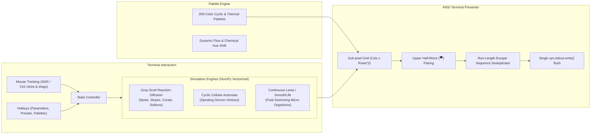

# termarium: Cellular Automata & Reaction-Diffusion Terrarium

Interactive terminal psychedelic generative simulation engine rendering at 60 FPS using NumPy, 24-bit ANSI true-color, and Unicode half-blocks (`▀`).

---

## 1. Core Architecture

---

## 2. Simulations & Mathematical Recipes

### 1. Gray-Scott Reaction-Diffusion
Models two virtual chemical species, $U$ and $V$, diffusing across a 2D toroidal lattice and reacting via:
$$U + 2V \rightarrow 3V, \qquad V \rightarrow P$$

Discrete PDEs updated via 5-point or 9-point Laplacian stencils:
$$\frac{\partial U}{\partial t} = D_u \nabla^2 U - U V^2 + F(1 - U)$$
$$\frac{\partial V}{\partial t} = D_v \nabla^2 V + U V^2 - (F + k)V$$

#### Iconic Parameter Regimes $(F, k)$:
- **Coral Growth / Labyrinths**: $F=0.0545, k=0.0620$
- **Mitosis / Dividing Bacteria**: $F=0.0367, k=0.0649$
- **Pulsing Solitons / Waves**: $F=0.0140, k=0.0540$
- **Leopard / Cheetah Spots**: $F=0.0300, k=0.0620$
- **Fingerprint Spirals**: $F=0.0180, k=0.0510$

---

### 2. Cyclic Cellular Automata (CCA)
A multi-state grid with $N$ states ($0 \dots N-1$). A cell at state $s$ advances to $(s + 1) \bmod N$ if at least $T$ (threshold) of its neighbors have state $(s + 1) \bmod N$.
- Range: 1 to 3 (Moore or Von Neumann neighborhood).
- Produces self-organizing rotating Archimedean spirals, turbulent color crystals, and rock-paper-scissors demoscene waves.

---

### 3. Continuous Lenia / SmoothLife
A continuous generalization of Conway's Game of Life:
- Space, state, and time are continuous: $A(x, y) \in [0, 1]$.
- **Neighborhood kernel**: Concentric rings with normalized Gaussian cross-section.
- **Growth function**: Bell curve mapping local neighborhood density to growth $\in [-1, 1]$:
  $$G(u) = 2 \exp\!\left(-\frac{(u - \mu)^2}{2\sigma^2}\right) - 1$$
- Generates lifelike, morphing, pulsating soliton "creatures" that glide, divide, and interact smoothly.

---

## 3. Interactive Features
- **Mouse Seeding**: Click or drag to inject chemicals, paint cells, or spawn localized wave seeds.
- **Live Parameter Mutation**: Adjust Feed ($F$), Kill ($k$), diffusion ratios, and thresholds on the fly.
- **Lava Lamp / Chaos Mutator**: Autonomous slow parameter drift so the terrarium self-evolves indefinitely without freezing.
- **Palettes**: Cycling thermal, electric neon, deep abyss, acid bioluminescence, and monochromatic electron-microscope shaders.
